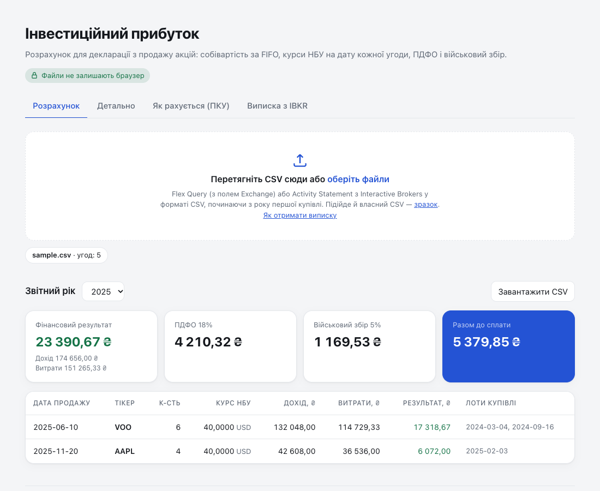

# Інвестиційний прибуток у гривнях

Виписка брокера (CSV) → інвестиційний прибуток за ПКУ: FIFO, курси НБУ на дату кожної угоди, перенесення збитків,
ПДФО і військовий збір. Файли не залишають браузер.

[](https://github.com/lev-oxr/ua-investment-tax/actions/workflows/ci.yml)
[](https://lev-oxr.github.io/ua-investment-tax/)
[](LICENSE)

**Сайт:** https://lev-oxr.github.io/ua-investment-tax/



## Можливості

- **Формати:** IBKR Flex Query, IBKR Activity Statement і власний CSV. Кілька файлів разом, дублікати між ними відкидаються.
- **FIFO:** комісія купівлі розподіляється пропорційно до проданої кількості, дробові акції підтримуються.
- **Курси НБУ** на дату кожної купівлі й продажу, з кешем у браузері.
- **Перенесення збитків** на наступні роки до повного погашення.
- **Правило 30 днів:** продажі зі збитком, біля яких є купівля тих самих акцій у межах ±30 днів, позначаються попередженням із місцем виконання угод.
- **Детальний розрахунок:** кожен продаж по лотах, кожен крок — з посиланням на пункт ПКУ.
- **Декларація (Ф1):** додаток Ф1 (рядки 1–5.2) і рядок 10.8 декларації за [Інструкцією](https://zakon.rada.gov.ua/laws/show/z1298-15#n1693) (наказ Мінфіну № 859, ред. від 06.02.2026); підказка, яку треба звірити з бланком.
- **Експорт** продажів року в CSV.

## Приватність

Сторінка читає файли локально через File API і нікуди їх не надсилає. Єдиний мережевий запит — курс валюти на дату
до `bank.gov.ua`. Це гарантує сам браузер: Content-Security-Policy в `index.html` дозволяє з'єднання лише з
`https://bank.gov.ua`, а скрипти й стилі — лише з того самого сайту. Шрифти системні, лічильників і аналітики немає.

## Як рахується

| Крок               | Правило                                                                             | ПКУ                                                                                                                                                |
| ------------------ | ----------------------------------------------------------------------------------- | -------------------------------------------------------------------------------------------------------------------------------------------------- |
| Витрати на купівлю | (кількість × ціна + комісія) × курс НБУ на дату купівлі                             | [пп. 170.2.2](https://zakon.rada.gov.ua/laws/show/2755-17#n3981), [пп. 14.1.96-1](https://zakon.rada.gov.ua/laws/show/2755-17#n13514)              |
| Дохід від продажу  | кількість × ціна × курс НБУ на дату продажу                                         | [п. 164.4](https://zakon.rada.gov.ua/laws/show/2755-17#n3690)                                                                                      |
| Результат року     | сума результатів усіх продажів мінус непогашений збиток минулих років               | [пп. 170.2.3](https://zakon.rada.gov.ua/laws/show/2755-17#n3997), [пп. 170.2.6](https://zakon.rada.gov.ua/laws/show/2755-17#n4005)                 |
| Податок            | ПДФО 18% і військовий збір (1,5% до 2024 року, 5% з 2024-го) з додатного результату | [пп. 167.5.1](https://zakon.rada.gov.ua/laws/show/2755-17#n11196), [п. 16-1 підр. 10 розд. XX](https://zakon.rada.gov.ua/laws/show/2755-17#n22758) |
| Правило 30 днів    | лише попередження: для угод на фондовій біржі воно не діє                           | [пп. 170.2.4](https://zakon.rada.gov.ua/laws/show/2755-17#n3998), [пп. 170.2.6](https://zakon.rada.gov.ua/laws/show/2755-17#n4017)                 |

Гривневі суми округлюються до копійок на кожному кроці, тож показана арифметика завжди сходиться.
Посилання ведуть на ПКУ в редакції від 27.10.2026 (перевірено 31.10.2026).

## Як отримати виписку з IBKR

Рекомендований формат — **Flex Query**: розділ Trades, рівень Execution, поле Exchange, CSV, окремий запуск за кожен рік,
починаючи з року відкриття рахунку. Покроковий гайд — на вкладці «Виписка з IBKR» на сайті.

Власний CSV ([зразок](site/sample.csv)): `date,type,symbol,qty,price,currency[,fee]`, дата `YYYY-MM-DD`, тип `BUY` або `SELL`.

## Обмеження

- Рахуються лише акції. Дивіденди, опціони, варанти й валютні обміни не враховано.
- Спліти, злиття та перенесення позицій між брокерами не враховано: без ранніх купівель продаж дасть помилку.
- Поріг неоподатковуваного доходу пп. 170.2.8 не застосовано.
- Датою доходу береться дата угоди, а не розрахунку (T+1).
- FIFO — вибір інструмента: ПКУ вимагає лише пропорційного списання витрат при частковому продажу.
- Ставка військового збору за 2024 рік — 5% на весь рік, хоча до 01.12.2024 діяла 1,5%. Сторінка просить це звірити.

## Розробка

Без фреймворків і збирання: ES-модулі, які браузер і Node читають напряму. Потрібен Node.js 22+.

```bash
npm ci          # ESLint і Prettier
npm start       # http://localhost:8765
npm test        # node:test
npm run lint && npm run format:check
```

```
site/            # публікується на GitHub Pages
  core/          # чиста логіка без DOM: CSV, парсери брокерів, FIFO, правило 30 днів, податки, довідник ПКУ
  ui/render.js   # дані → HTML, усе з файлу проходить через esc()
  nbu.js         # курси НБУ
  app.js         # стан сторінки й події
test/            # тести й синтетичні фікстури
docs/            # скриншот для README
```

Особисті виписки тримайте в `data/`: папка в `.gitignore`, у репозиторій вона не потрапить.

## Дисклеймер

Це розрахунок, а не податкова порада. Перед поданням декларації звірте результат з бухгалтером.
Проєкт не пов'язаний з Interactive Brokers і не схвалений ними.

## Ліцензія

[MIT](LICENSE)
